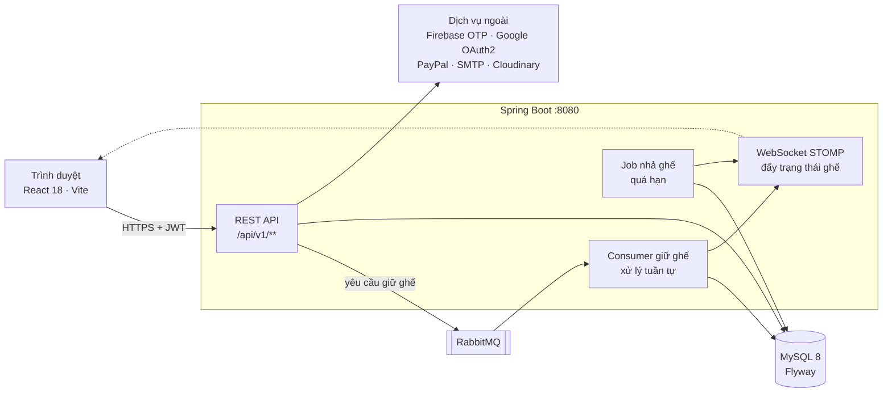
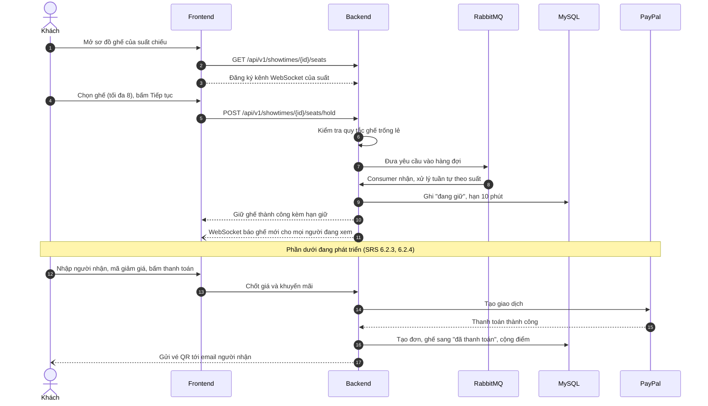
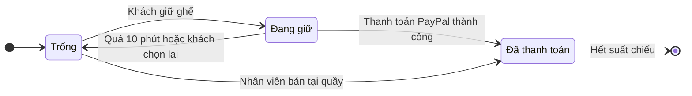
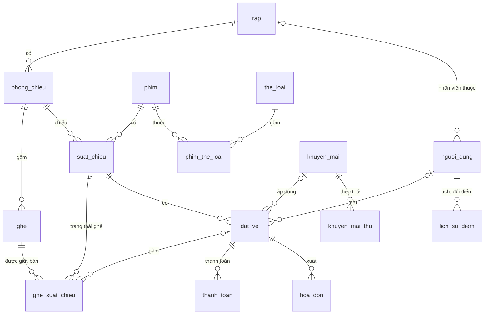
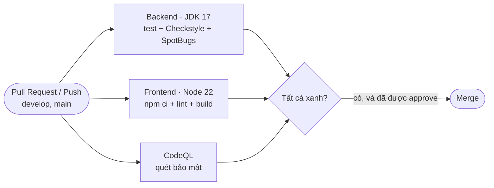
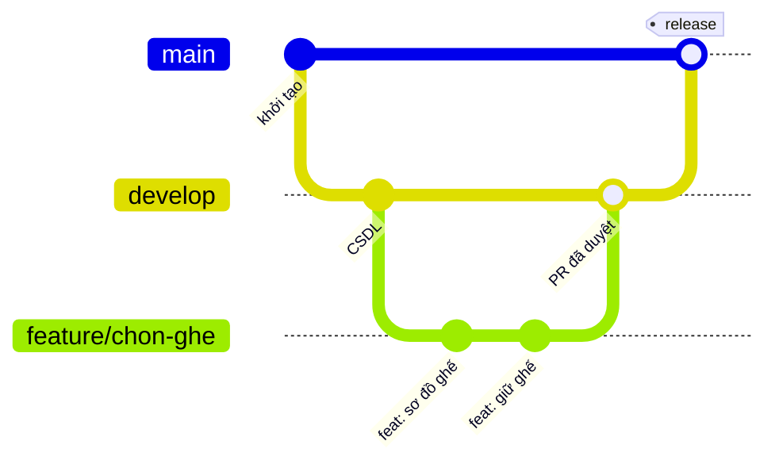

<div align="center">

# 🎬 Galaxy Lumière – Hệ thống Quản lý Rạp chiếu phim

**Website đặt vé trực tuyến và quản lý vận hành cho chuỗi nhiều rạp chiếu phim**

Đồ án thực tập · Đại học Duy Tân (DTU) × CodeGym Đà Nẵng (CGDN) · Team 4


[📋 Trello](https://trello.com/b/zNGT0IjN/dtu-projectteam-4-qu%E1%BA%A3n-ly-r%E1%BA%A1p-chi%E1%BA%BFu-phim) ·
[🎨 Figma](https://www.figma.com/design/kWLLFcZJcCFhAybCJE9oNv) ·
[💻 GitHub](https://github.com/dtu-cgdn-team4/cinema-management-system-v2) ·
[🗄️ Thiết kế CSDL](docs/database/database.md)

</div>

---

## 📑 Mục lục

1. [Giới thiệu](#-giới-thiệu)
2. [Nhóm thực hiện](#-nhóm-thực-hiện)
3. [Tính năng và tiến độ](#-tính-năng-và-tiến-độ)
4. [Quy tắc nghiệp vụ chính](#-quy-tắc-nghiệp-vụ-chính)
5. [Công nghệ](#-công-nghệ)
6. [Kiến trúc hệ thống](#-kiến-trúc-hệ-thống)
7. [Luồng đặt vé online](#-luồng-đặt-vé-online)
8. [Cơ sở dữ liệu](#-cơ-sở-dữ-liệu)
9. [Cấu trúc thư mục](#-cấu-trúc-thư-mục)
10. [Cài đặt và chạy](#-cài-đặt-và-chạy)
11. [Kiểm thử và CI](#-kiểm-thử-và-ci)
12. [Quy trình làm việc](#-quy-trình-làm-việc)
13. [Tài liệu dự án](#-tài-liệu-dự-án)

---

## 🎯 Giới thiệu

Galaxy Lumière là hệ thống đặt vé và quản lý cho **chuỗi nhiều rạp**, chỉ chiếu phim **2D**. Hệ thống phục vụ bốn nhóm người dùng:

| Vai trò | Làm được gì |
|---|---|
| 👀 **Khách vãng lai** | Xem phim, lịch chiếu, rạp, khuyến mãi, giá vé |
| 🙋 **Thành viên** | Đặt vé online, chọn ghế theo thời gian thực, thanh toán PayPal, nhận vé QR qua email, tích điểm |
| 🧑‍💼 **Nhân viên** | Bán vé tại quầy, soát vé bằng mã QR, tìm vé theo số điện thoại (chỉ ở rạp của mình) |
| 🛠️ **Quản trị viên** | Quản lý phim, phòng chiếu, suất chiếu, giá vé, khuyến mãi, nhân viên, thành viên, xem thống kê |

Bài toán chính mà dự án giải quyết:

- **Không bán trùng ghế khi đông người:** yêu cầu giữ ghế đi qua hàng đợi RabbitMQ và được xử lý tuần tự. Trạng thái ghế được đẩy tức thì qua WebSocket cho mọi người đang xem cùng suất. Hệ thống đặt mục tiêu chịu được 1000 người dùng đồng thời.
- **Đặt vé online trọn vẹn:** khách chọn ghế, thanh toán PayPal rồi nhận vé điện tử có mã QR. Ở rạp, nhân viên chỉ cần quét mã.
- **Vận hành nhiều rạp:** mỗi nhân viên gắn với một rạp. Giá vé và khuyến mãi dùng chung cho cả chuỗi. Thống kê lọc được theo từng rạp.

> **Ngoài phạm vi hiện tại:** phim 3D, ghế đôi, huỷ vé, hoàn tiền, đổi suất, bán combo bắp nước, đánh giá phim, chia hạng thành viên.

---

## 👥 Nhóm thực hiện

**Mentor hướng dẫn:** Trương Tấn Hải

| Thành viên | Viết tắt |
|---|---|
| Nguyễn Minh Nguyên | NguyenNM |
| Nguyễn Vinh Hà | HaNV |
| Nguyễn Thế Huy | HuyNT |
| Trương Tấn Quang Vũ | VuTTQ |
| Dũ Ngọc Minh Tân | TamDN |
| Trần Văn Long | LongTV |

---

## ✨ Tính năng và tiến độ

✅ Đã có trên `develop` · 🚧 Đang làm · 🗓️ Kế hoạch

<table>
<tr><th>Phân hệ</th><th>Tính năng</th><th>SRS</th><th></th></tr>

<tr><td rowspan="10">🙋 <b>Khách hàng</b></td>
<td>Đăng ký tài khoản, xác thực số điện thoại bằng OTP (Firebase)</td><td>6.3</td><td>✅</td></tr>
<tr><td>Đăng nhập bằng tài khoản hoặc Google, khoá tạm sau 5 lần nhập sai</td><td>6.1</td><td>✅</td></tr>
<tr><td>Quản lý thông tin tài khoản, đổi mật khẩu, đổi email và số điện thoại</td><td>6.4.1</td><td>✅</td></tr>
<tr><td>Danh sách phim đang chiếu, sắp chiếu; tìm kiếm và lọc theo thể loại</td><td>6.5.1, 6.5.3</td><td>✅</td></tr>
<tr><td>Chi tiết phim và các suất chiếu của phim</td><td>6.5.2</td><td>✅</td></tr>
<tr><td>Chọn rạp, xem lịch chiếu theo rạp và ngày</td><td>6.2.1, 6.7</td><td>✅</td></tr>
<tr><td>Chọn ghế theo thời gian thực, giữ ghế 10 phút</td><td>6.2.2</td><td>✅</td></tr>
<tr><td>Vé đã đặt, chi tiết vé kèm mã QR</td><td>6.4.2</td><td>✅</td></tr>
<tr><td>Xác nhận đặt vé, thanh toán PayPal, gửi vé QR qua email</td><td>6.2.3, 6.2.4</td><td>🚧</td></tr>
<tr><td>Khuyến mãi, lịch sử điểm, bảng giá vé</td><td>6.6, 6.4.3, 6.8</td><td>🗓️</td></tr>

<tr><td rowspan="2">🧑‍💼 <b>Nhân viên</b></td>
<td>Bán vé tại quầy, xuất hoá đơn</td><td>6.9</td><td>🗓️</td></tr>
<tr><td>Soát vé bằng mã QR, tìm vé theo số điện thoại người nhận</td><td>6.10</td><td>🗓️</td></tr>

<tr><td rowspan="7">🛠️ <b>Quản trị</b></td>
<td>Đăng nhập và chuyển vào trang quản trị</td><td>6.1</td><td>✅</td></tr>
<tr><td>Quản lý phim: danh sách, ngừng phát hành (xoá mềm)</td><td>6.14</td><td>✅</td></tr>
<tr><td>Thêm, sửa phim; xếp lịch chiếu, chặn trùng giờ trong cùng phòng</td><td>6.14</td><td>🗓️</td></tr>
<tr><td>Thống kê doanh thu, phim, suất chiếu (biểu đồ, xuất Excel)</td><td>6.16</td><td>🚧</td></tr>
<tr><td>Phòng chiếu và sơ đồ ghế</td><td>6.12</td><td>🗓️</td></tr>
<tr><td>Bảng giá vé, khuyến mãi</td><td>6.8, 6.15</td><td>🗓️</td></tr>
<tr><td>Quản lý nhân viên, thành viên</td><td>6.11, 6.13</td><td>🗓️</td></tr>
</table>

---

## 📐 Quy tắc nghiệp vụ chính

| Chủ đề | Quy tắc |
|---|---|
| 🎟️ Số ghế | Bấm thẳng vào ghế trên sơ đồ, mỗi lần đặt từ 1 đến 8 ghế |
| ⏱️ Giữ ghế | Giữ 10 phút tính theo giờ server, quá hạn thì tự nhả. Mỗi khách chỉ giữ ghế ở một suất tại một thời điểm |
| 🪑 Ghế trống lẻ | Không được chọn ghế để lại đúng 1 ghế trống kẹp giữa các ghế đã có người, hoặc nằm sát lối đi hay đầu hàng |
| 💳 Thanh toán | Đơn online chỉ thanh toán qua PayPal. Đơn chỉ được tạo khi thanh toán thành công |
| 💰 Giá vé | Phụ thuộc thứ trong tuần và loại ghế (thường, VIP). Giá được chốt lúc khách bấm thanh toán, đổi bảng giá không ảnh hưởng vé đã đặt |
| 🎁 Khuyến mãi | Trừ thẳng vào tiền vé, áp dụng tự động hoặc nhập mã, không cộng dồn với đổi điểm |
| ⭐ Điểm | 10.000đ = 1 điểm, cộng lúc đặt, không hết hạn, chỉ đổi điểm tại quầy |
| 🚫 Sau khi mua | Không huỷ, không hoàn tiền, không đổi suất. Vé có hiệu lực đến hết suất chiếu |

---

## 🧰 Công nghệ

| Tầng | Công nghệ |
|---|---|
| **Backend** | Java 17, Spring Boot 3.5 (Web, Data JPA, Validation, Security, WebSocket, AMQP), JJWT, Lombok, SpringDoc OpenAPI (Swagger UI) |
| **Frontend** | React 18, Vite 8, React Router 6, Tailwind CSS 4, Axios, STOMP.js, lucide-react, qrcode.react |
| **Cơ sở dữ liệu** | MySQL 8 với Flyway migration; H2 (chế độ MySQL) khi chạy thử và khi test |
| **Hàng đợi, realtime** | RabbitMQ (broker nhúng Qpid khi test), WebSocket STOMP |
| **Xác thực** | JWT (access token và refresh token), BCrypt, Google OAuth2, Firebase Phone Auth (OTP SMS) |
| **Chất lượng mã** | Checkstyle, SpotBugs, JaCoCo, ESLint, GitHub Actions, CodeQL |
| **Dự kiến tích hợp** | PayPal Sandbox (thanh toán), SMTP (email vé QR), Cloudinary (ảnh poster) |

---

## 🧱 Kiến trúc hệ thống

Monorepo gồm `backend/` (Spring Boot) và `frontend/` (React). Backend chia theo **module nghiệp vụ**. Module này cần dữ liệu của module khác thì gọi qua service của module đó, không dùng thẳng repository.



| Module backend | Phụ trách |
|---|---|
| `auth`, `user` | Đăng ký, đăng nhập, token, tài khoản |
| `cinema`, `room` | Rạp, phòng chiếu, sơ đồ ghế |
| `movie`, `moviedetail`, `showtime` | Phim, chi tiết phim, suất chiếu |
| `pricing`, `promotion`, `loyalty` | Bảng giá, khuyến mãi, điểm tích luỹ |
| `booking`, `payment`, `ticket` | Giữ ghế (queue, scheduler), thanh toán, vé của thành viên |
| `counter`, `report` | Bán vé tại quầy, thống kê |

---

## 🎫 Luồng đặt vé online



Vòng đời một ghế trong một suất chiếu:



Ràng buộc unique `(suat_chieu_id, ghe_id)` trong bảng `ghe_suat_chieu` là lớp chặn cuối cùng: dù có lỗi ở tầng trên, hai người cũng không thể cùng có một ghế.

---

## 💾 Cơ sở dữ liệu

MySQL 8, database `cinema_db`, bảng mã `utf8mb4`. Tên bảng và tên cột viết tiếng Việt không dấu, kiểu `snake_case`. Bảng nghiệp vụ dùng **xoá mềm** qua cột `trang_thai` (1: hoạt động, 2: đã xoá). Riêng bản ghi giữ ghế hết hạn được xoá hẳn để người khác giữ lại được ghế đó.



`bang_gia` đứng riêng, không có khoá ngoại: giá một ghế tra theo thứ của ngày chiếu và loại ghế. Chi tiết từng cột xem [docs/database/database.md](docs/database/database.md), sơ đồ gốc ở [ERD.jpg](docs/database/ERD.jpg).

---

## 📂 Cấu trúc thư mục

<details>
<summary>Bấm để xem cây thư mục</summary>

```text
cinema-management-system-v2/
├── .github/
│   ├── PULL_REQUEST_TEMPLATE.md        # Mẫu mô tả PR
│   └── workflows/                      # ci.yml (build, test, lint), codeql.yml (quét bảo mật)
├── backend/                            # Spring Boot 3.5, Java 17
│   ├── src/main/java/com/cgdn/cinema/
│   │   ├── CinemaApplication.java
│   │   ├── common/                     # constants, enums, ApiResponse<T>
│   │   ├── config/                     # CORS, OpenAPI, Jackson, Scheduling
│   │   ├── exception/                  # GlobalExceptionHandler, BusinessException, ErrorCode
│   │   ├── security/                   # JWT, Google OAuth2, khoá tài khoản
│   │   ├── infrastructure/             # messaging, websocket, sms, mail, payment, storage, export
│   │   └── modules/                    # Mỗi module: controller, service, repository, entity, dto, mapper
│   ├── src/main/resources/
│   │   ├── application.yml
│   │   └── db/
│   │       ├── migration/              # Flyway V<số>__<mo_ta>.sql
│   │       └── seed/                   # Dữ liệu mẫu R__sample_data.sql
│   ├── src/test/resources/             # Profile testdata, mq: H2 + broker nhúng + db/test-seed
│   ├── firebase.json                   # Cấu hình Firebase Auth Emulator
│   └── .env.example
├── frontend/                           # React 18, Vite 8, Tailwind CSS 4
│   ├── src/
│   │   ├── features/                   # auth, movies, cinemas, booking, tickets, account, admin...
│   │   ├── routes/                     # Khai báo route, chặn theo vai trò
│   │   ├── layouts/                    # Layout khách, quản trị
│   │   ├── components/                 # Component dùng chung
│   │   ├── services/                   # Axios client gắn JWT, socket client
│   │   ├── context/                    # AuthContext
│   │   └── utils/                      # Định dạng tiền, ngày giờ
│   └── .env.example
└── docs/
    ├── database/                       # database.md, ERD.jpg
    └── api/                            # Postman collection, hướng dẫn test OTP
```

Hướng dẫn riêng: [backend/README.md](backend/README.md) · [frontend/README.md](frontend/README.md)

</details>

---

## 🚀 Cài đặt và chạy

### Yêu cầu

| Công cụ | Phiên bản |
|---|---|
| JDK | 17 hoặc 21 (broker nhúng khi chạy thử chưa hỗ trợ JDK 23 trở lên) |
| Maven | 3.8 trở lên |
| Node.js | 20.19+ hoặc 22.12+ (Vite 8, Tailwind CSS 4) |
| MySQL | 8.0 trở lên (không cần nếu chạy nhanh bằng H2) |
| Docker | Tuỳ chọn, để chạy RabbitMQ |

```bash
git clone https://github.com/dtu-cgdn-team4/cinema-management-system-v2.git
cd cinema-management-system-v2
```

### ⚡ Cách 1: Chạy nhanh, không cần MySQL và RabbitMQ

Backend dùng H2 trong bộ nhớ, broker nhúng và dữ liệu `db/test-seed`. Suất chiếu được tạo tính từ ngày hôm nay, nên lúc nào cũng có suất để đặt thử.

```bash
cd backend
cp -n .env.example .env
FIREBASE_AUTH_EMULATOR_HOST=localhost:9099 \
  mvn spring-boot:test-run -Dspring-boot.run.profiles=testdata,mq
```

Dữ liệu mất khi tắt backend. Tài khoản `khach1` và `khach2`, mật khẩu `123456`.

### 🐬 Cách 2: Chạy đầy đủ với MySQL và RabbitMQ

**Bước 1. Tạo database rỗng** (Flyway tự tạo bảng và nạp dữ liệu mẫu ở lần chạy đầu, không chạy tay file SQL nào):

```sql
CREATE DATABASE cinema_db CHARACTER SET utf8mb4 COLLATE utf8mb4_unicode_ci;
```

**Bước 2. Chạy RabbitMQ** cho hàng đợi giữ ghế:

```bash
docker run -d --name cinema-rabbitmq -p 5672:5672 -p 15672:15672 rabbitmq:4-management
# Các lần sau: docker start cinema-rabbitmq
```

Trang quản lý RabbitMQ ở <http://localhost:15672>, tài khoản `guest` / `guest`. Thiếu RabbitMQ thì backend vẫn khởi động, nhưng API giữ ghế trả 503 "Hệ thống đang bận".

**Bước 3. Cấu hình backend:** `cp -n backend/.env.example backend/.env` (`-n` để không ghi đè file đã có; Windows CMD dùng `copy`), rồi sửa cho đúng máy của bạn:

| Biến | Ý nghĩa | Giá trị mẫu |
|---|---|---|
| `DB_HOST`, `DB_PORT` | Máy và cổng MySQL | `localhost`, `3306` |
| `DB_NAME` | Database tạo ở bước 1 | `cinema_db` |
| `DB_USERNAME`, `DB_PASSWORD` | Tài khoản MySQL | `root`, mật khẩu của bạn |
| `RABBITMQ_*` | Kết nối RabbitMQ | Để nguyên nếu chạy Docker như trên |
| `FIREBASE_PROJECT_ID` | Project Firebase cho OTP | Mã project, chạy local đặt tuỳ ý |

- Ghi giá trị trực tiếp, không bọc trong dấu nháy.
- `.env` chứa mật khẩu, đã nằm trong `.gitignore`. Cần biến mới thì thêm tên biến kèm giá trị mẫu vào `.env.example`.
- Máy không có service account Google thì đặt **biến môi trường** `FIREBASE_AUTH_EMULATOR_HOST=localhost:9099` trước khi chạy. Biến này phải là biến môi trường thật, ghi trong `.env` không có tác dụng. OTP đăng ký chỉ hoạt động khi bật Firebase Auth Emulator.

**Bước 4. Chạy backend:**

```bash
cd backend
FIREBASE_AUTH_EMULATOR_HOST=localhost:9099 mvn spring-boot:run
```

Kết nối thành công khi log có dòng `Successfully applied` (lần đầu) hoặc `is up to date`, tiếp theo là `Started CinemaApplication`.

### 🎨 Chạy frontend

```bash
cd frontend
cp -n .env.example .env
npm install
npm run dev
```

### 🔗 Địa chỉ và cổng

| Dịch vụ | Địa chỉ |
|---|---|
| Website | <http://localhost:5174> |
| Backend API | <http://localhost:8080/api/v1> |
| Swagger UI | <http://localhost:8080/swagger-ui.html> |
| RabbitMQ Management | <http://localhost:15672> |
| Firebase Auth Emulator | `localhost:9099` |

### 👤 Tài khoản mẫu (dữ liệu MySQL)

Mật khẩu chung: `123456`

| Vai trò | Tài khoản |
|---|---|
| Quản trị viên | `admin` |
| Nhân viên | `staff_landmark`, `staff_danang` |
| Khách hàng | `hoangnam`, `thanhhang`, `tamdu` |

> Suất chiếu trong dữ liệu mẫu MySQL mang ngày của lần nạp đầu tiên, nên sau vài ngày sẽ không còn suất sắp chiếu. Muốn đặt thử, dùng **Cách 1** (suất chiếu luôn tính từ hôm nay).

<details>
<summary>🩺 Lỗi thường gặp</summary>

| Lỗi | Nguyên nhân và cách xử lý |
|---|---|
| `Access denied for user ...` | Sai `DB_USERNAME` hoặc `DB_PASSWORD` trong `backend/.env` |
| `Unknown database 'cinema_db'` | Chưa tạo database, hoặc `DB_NAME` gõ sai |
| `Communications link failure` | MySQL chưa chạy, hoặc sai `DB_HOST`, `DB_PORT` |
| `Validate failed: Migrations have failed validation` | Database còn lịch sử migration cũ, ví dụ từ nhánh khác. Xoá và tạo lại database (mất toàn bộ dữ liệu local, dữ liệu mẫu sẽ được nạp lại) |
| Backend dừng ở bước tạo `FirebaseAuth` | Chưa đặt biến môi trường `FIREBASE_AUTH_EMULATOR_HOST` khi không có service account |
| Trang trắng, console báo `Invalid hook call` | Cache Vite bị lệch, chạy lại `npm run dev -- --force` |
| Frontend gọi API bị lỗi CORS | `CORS_ALLOWED_ORIGINS` và `FRONTEND_URL` trong `backend/.env` phải là `http://localhost:5174` |

```sql
DROP DATABASE cinema_db;
CREATE DATABASE cinema_db CHARACTER SET utf8mb4 COLLATE utf8mb4_unicode_ci;
```

</details>

---

## 🧪 Kiểm thử và CI

| Phần | Lệnh |
|---|---|
| Backend: test | `cd backend && mvn test` (H2 và broker nhúng, không cần MySQL, RabbitMQ) |
| Backend: kiểm tra như CI | `mvn -B clean test checkstyle:check spotbugs:check` |
| Frontend: test | `cd frontend && npm test` |
| Frontend: lint, build | `npm run lint && npm run build` |

Mỗi PR và mỗi lần push vào `develop` hoặc `main` đều chạy GitHub Actions:



---

## 🔀 Quy trình làm việc



| Nhánh | Vai trò |
|---|---|
| `main` | Code đã sẵn sàng phát hành, dùng để demo và nghiệm thu. Không commit trực tiếp |
| `develop` | Nhánh tích hợp, luôn build được. Chỉ nhận thay đổi qua Pull Request |
| `feature/#<trello-id>_<mo-ta>` | Một task Trello, tách từ `develop`. Ví dụ `feature/#6.2.1.2_chon-ghe` |

**Commit** theo dạng `<type>: <mô tả>`:

| Type | Dùng khi |
|---|---|
| `feat` | Thêm tính năng |
| `fix` | Sửa lỗi |
| `refactor` | Sắp xếp lại code, không đổi hành vi |
| `docs` | Tài liệu |
| `test` | Thêm hoặc sửa test |
| `chore` | Cấu hình, build, thư viện |

**Pull Request** vào `develop` theo [mẫu PR](.github/PULL_REQUEST_TEMPLATE.md): mã thẻ Trello, mục tiêu thay đổi, ảnh chụp kết quả test local, rủi ro và việc người khác cần làm sau khi merge. Chỉ merge khi CI xanh, đã có ít nhất một approve và không còn comment nào chưa xử lý.

---

## 📚 Tài liệu dự án

| Tài liệu | Nội dung |
|---|---|
| [docs/database/database.md](docs/database/database.md) | Quy ước, danh sách bảng, ràng buộc, migration |
| [docs/database/ERD.jpg](docs/database/ERD.jpg) | Sơ đồ quan hệ thực thể |
| [docs/api/registration-otp-postman.md](docs/api/registration-otp-postman.md) | Test đăng ký OTP bằng Postman |
| [Postman collection](docs/api/Cinema_Movie_Admin.postman_collection.json) | API quản lý phim |
| Swagger UI | Danh sách API đầy đủ khi backend đang chạy |

Các tài liệu sau chỉ lưu nội bộ trong nhóm (đã đưa vào `.gitignore`, không có trên GitHub): SRS v1.1, file Q&A với mentor, `business-rules.md`, `architecture.md`, `api-conventions.md`, `coding-conventions.md`, `git-flow.md`.

---

<div align="center">

Made with ❤️ by **Team 4** · DTU × CodeGym Đà Nẵng · 2026

</div>
