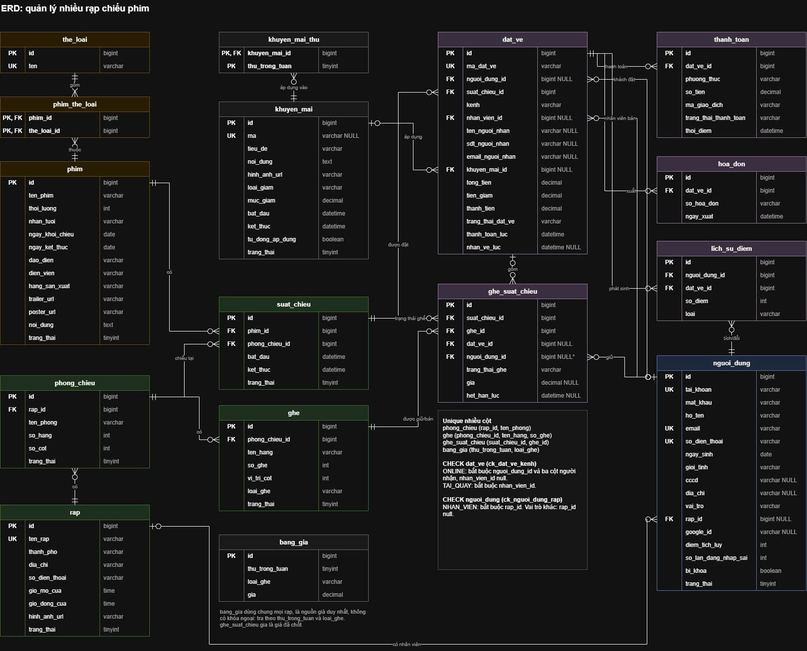

# Cơ sở dữ liệu

MySQL 8, database `cinema_db`, `utf8mb4` / `utf8mb4_unicode_ci`. Thiết kế lấy theo sơ đồ [ERD.jpg](ERD.jpg): 16 bảng, hệ thống nhiều rạp. Sơ đồ lược bỏ `ngay_tao`, `ngay_cap_nhat`.



## Quy ước

- **Tên bảng, tên cột:** tiếng Việt không dấu, `snake_case` (SRS mục 7). Tên class và field Java viết tiếng Anh, ánh xạ bằng `@Table` / `@Column`.
- **Khóa chính:** `id BIGINT AUTO_INCREMENT`. Khóa ngoại đặt tên `<bang>_id`. Riêng `dat_ve.nhan_vien_id` trỏ tới `nguoi_dung`.
- **NULL:** cột chỉ được null khi sơ đồ ghi `NULL`.
- **Xóa mềm:** bảng nghiệp vụ chính có cột `trang_thai TINYINT` (1: đang hoạt động, 2: đã xóa). Xóa dữ liệu bằng cách đổi `trang_thai` thành 2.
  - Trạng thái nghiệp vụ dùng cột tên khác (`trang_thai_dat_ve`, `trang_thai_ghe`, `trang_thai_thanh_toan`) để không lẫn với cờ xóa mềm.
  - Ngoại lệ duy nhất: bản ghi giữ ghế hết hạn trong `ghe_suat_chieu` được xóa vật lý, vì unique `(suat_chieu_id, ghe_id)` cần chỗ trống để người khác giữ lại ghế.
- **Tiền:** `DECIMAL(12,0)`, đơn vị VND.
- **Thời gian:** `DATETIME`, múi giờ `Asia/Ho_Chi_Minh`. Mọi bảng có `ngay_tao`, `ngay_cap_nhat`.
- **Độ dài đã chốt (Q&A #7):** CCCD `VARCHAR(12)`, tên phim `VARCHAR(255)`, trailer `VARCHAR(500)` (URL). Không dùng `NVARCHAR`: database đã là `utf8mb4`, còn `NVARCHAR` của MySQL là `utf8mb3`.
- **Migration:** Flyway, file `backend/src/main/resources/db/migration/V<số>__<mo_ta>.sql`. Migration đã có thì giữ nguyên; thay đổi schema bằng migration mới. SQL phải chạy được trên cả MySQL 8 và H2 chế độ MySQL (profile `h2`).
- **Dữ liệu mẫu:** `db/seed/R__*.sql`, chỉ dùng khi phát triển. Đổi file seed thì tạo lại database.

| Migration | Nội dung |
|---|---|
| `V1__phim_phong_suat_chieu` | Phim, thể loại, phòng, ghế, suất chiếu, bảng giá |
| `V2__ghe_suat_chieu` | Bản đầu của `ghe_suat_chieu`, còn cột tạm `ma_phien` |
| `V3__theo_erd` | Đưa schema về đúng sơ đồ: thêm `rap`, `phong_chieu.rap_id`, người dùng, khuyến mãi, đặt vé, thanh toán, hóa đơn, điểm; `ghe_suat_chieu` bỏ `ma_phien`, thêm `nguoi_dung_id`, `dat_ve_id`, `gia` |

## Rạp, phòng, ghế

Mỗi phòng thuộc một rạp. Suất chiếu, ghế và đơn đặt vé thuộc rạp qua `phong_chieu`, không lưu thêm `rap_id`. Thống kê lọc theo rạp cũng đi theo đường này.

### `rap`

| Cột | Kiểu | Ghi chú |
|---|---|---|
| `id` | bigint | PK |
| `ten_rap` | varchar | Unique |
| `thanh_pho` | varchar | Khu vực trên màn chọn rạp |
| `dia_chi` | varchar | |
| `so_dien_thoai` | varchar | |
| `gio_mo_cua` | time | |
| `gio_dong_cua` | time | |
| `hinh_anh_url` | varchar | |
| `trang_thai` | tinyint | Xóa mềm |

### `phong_chieu`

| Cột | Kiểu | Ghi chú |
|---|---|---|
| `id` | bigint | PK |
| `rap_id` | bigint | FK `rap` |
| `ten_phong` | varchar | Unique `(rap_id, ten_phong)`: hai rạp được đặt trùng tên phòng |
| `so_hang` | int | |
| `so_cot` | int | |
| `trang_thai` | tinyint | Xóa mềm |

### `ghe`

| Cột | Kiểu | Ghi chú |
|---|---|---|
| `id` | bigint | PK |
| `phong_chieu_id` | bigint | FK `phong_chieu` |
| `ten_hang` | varchar | A, B…, lưu dạng chữ vì có thể nhảy hàng |
| `so_ghe` | int | Unique `(phong_chieu_id, ten_hang, so_ghe)` |
| `vi_tri_cot` | int | Cột trên lưới, lối đi là cột không có ghế. Ví dụ ghế 03 ở cột 3, ghế 04 ở cột 5. Backend tách dãy ghế khi `vi_tri_cot` không liên tiếp |
| `loai_ghe` | varchar | THUONG, VIP |
| `trang_thai` | tinyint | Xóa mềm |

## Phim, suất chiếu

Phim dùng chung toàn hệ thống; rạp nào chiếu phim gì suy ra từ `suat_chieu`. Không có cột định dạng ở `phim`, `phong_chieu`, `suat_chieu`: phạm vi chỉ chiếu 2D (#34), màn hình ghi cố định "2D".

### `the_loai`

| Cột | Kiểu | Ghi chú |
|---|---|---|
| `id` | bigint | PK |
| `ten` | varchar | Unique |

### `phim`

| Cột | Kiểu | Ghi chú |
|---|---|---|
| `id` | bigint | PK |
| `ten_phim` | varchar | |
| `thoi_luong` | int | Phút |
| `nhan_tuoi` | varchar | P, K, T13, T16, T18 |
| `ngay_khoi_chieu` | date | |
| `ngay_ket_thuc` | date | |
| `dao_dien` | varchar | |
| `dien_vien` | varchar | |
| `hang_san_xuat` | varchar | |
| `trailer_url` | varchar | |
| `poster_url` | varchar | |
| `noi_dung` | text | |
| `trang_thai` | tinyint | Xóa mềm |

### `phim_the_loai`

| Cột | Kiểu | Ghi chú |
|---|---|---|
| `phim_id` | bigint | PK, FK `phim` |
| `the_loai_id` | bigint | PK, FK `the_loai` |

### `suat_chieu`

| Cột | Kiểu | Ghi chú |
|---|---|---|
| `id` | bigint | PK |
| `phim_id` | bigint | FK `phim` |
| `phong_chieu_id` | bigint | FK `phong_chieu` |
| `bat_dau` | datetime | |
| `ket_thuc` | datetime | Đã cộng thời gian dọn phòng. Backend chặn hai suất cùng phòng có khoảng `[bat_dau, ket_thuc)` giao nhau |
| `trang_thai` | tinyint | Xóa mềm |

## Giá, khuyến mãi

Giá và khuyến mãi dùng chung cho mọi rạp (chốt 06/11/2026), nên `bang_gia` và `khuyen_mai` không có `rap_id`.

### `bang_gia`

Nguồn giá duy nhất (#34), không có khóa ngoại: giá một ghế tra theo thứ của `suat_chieu.bat_dau` và `ghe.loai_ghe`. `suat_chieu` không có cột giá. Đổi `bang_gia` không ảnh hưởng vé đã đặt, vì `ghe_suat_chieu.gia` là giá đã chốt.

| Cột | Kiểu | Ghi chú |
|---|---|---|
| `id` | bigint | PK |
| `thu_trong_tuan` | tinyint | 1–7, ISO: 1 là Thứ hai. Unique `(thu_trong_tuan, loai_ghe)` |
| `loai_ghe` | varchar | THUONG, VIP |
| `gia` | decimal | |

### `khuyen_mai`

| Cột | Kiểu | Ghi chú |
|---|---|---|
| `id` | bigint | PK |
| `ma` | varchar NULL | Unique, null nếu áp dụng tự động |
| `tieu_de` | varchar | |
| `noi_dung` | text | |
| `hinh_anh_url` | varchar | |
| `loai_giam` | varchar | SO_TIEN, PHAN_TRAM |
| `muc_giam` | decimal | |
| `bat_dau` | datetime | |
| `ket_thuc` | datetime | |
| `tu_dong_ap_dung` | boolean | |
| `trang_thai` | tinyint | Xóa mềm |

### `khuyen_mai_thu`

Các thứ khuyến mãi được áp dụng; không có dòng nào nghĩa là mọi thứ. Khuyến mãi hợp lệ khi lúc xác nhận thanh toán còn trong `[bat_dau, ket_thuc]` (#25) và thứ của `suat_chieu.bat_dau` có trong bảng này. Ví dụ "Thứ 3 vui vẻ": một dòng giá trị 2. "Cuối tuần" (Thứ 6 đến Chủ nhật): ba dòng 5, 6, 7.

| Cột | Kiểu | Ghi chú |
|---|---|---|
| `khuyen_mai_id` | bigint | PK, FK `khuyen_mai` |
| `thu_trong_tuan` | tinyint | PK, 1–7 như `bang_gia` |

## Người dùng

### `nguoi_dung`

| Cột | Kiểu | Ghi chú |
|---|---|---|
| `id` | bigint | PK |
| `tai_khoan` | varchar | Unique |
| `mat_khau` | varchar | BCrypt |
| `ho_ten` | varchar | |
| `email` | varchar | Unique |
| `so_dien_thoai` | varchar | Unique |
| `ngay_sinh` | date | |
| `gioi_tinh` | varchar | |
| `cccd` | varchar NULL | |
| `dia_chi` | varchar NULL | |
| `vai_tro` | varchar | KHACH_HANG, NHAN_VIEN, ADMIN |
| `rap_id` | bigint NULL | FK `rap`, xem CHECK dưới đây |
| `google_id` | varchar NULL | |
| `diem_tich_luy` | int | |
| `so_lan_dang_nhap_sai` | int | |
| `bi_khoa` | boolean | |
| `trang_thai` | tinyint | Xóa mềm |

Nhân viên bắt buộc có `rap_id`, vai trò khác để null:

```sql
CONSTRAINT ck_nguoi_dung_rap CHECK (
    (vai_tro = 'NHAN_VIEN' AND rap_id IS NOT NULL) OR (vai_tro <> 'NHAN_VIEN' AND rap_id IS NULL)
)
```

## Đặt vé, thanh toán, điểm

### `dat_ve`

Đơn online chỉ được tạo sau khi PayPal báo thành công. Thông tin người nhận lưu theo từng đơn vì có thể khác chủ tài khoản: vé QR gửi tới `email_nguoi_nhan` (#31), nhân viên tìm vé theo `sdt_nguoi_nhan` (#19).

| Cột | Kiểu | Ghi chú |
|---|---|---|
| `id` | bigint | PK |
| `ma_dat_ve` | varchar | Unique |
| `nguoi_dung_id` | bigint NULL | FK `nguoi_dung`, khách đặt |
| `suat_chieu_id` | bigint | FK `suat_chieu` |
| `kenh` | varchar | ONLINE, TAI_QUAY |
| `nhan_vien_id` | bigint NULL | FK `nguoi_dung`, nhân viên bán |
| `ten_nguoi_nhan` | varchar NULL | |
| `sdt_nguoi_nhan` | varchar NULL | Có index |
| `email_nguoi_nhan` | varchar NULL | |
| `khuyen_mai_id` | bigint NULL | FK `khuyen_mai` |
| `tong_tien` | decimal | |
| `tien_giam` | decimal | |
| `thanh_tien` | decimal | |
| `trang_thai_dat_ve` | varchar | DA_THANH_TOAN |
| `thanh_toan_luc` | datetime | |
| `nhan_ve_luc` | datetime NULL | Lúc vé được soát lần đầu (SRS 6.10.3). Quét lại thì báo vé đã soát, không ghi đè |

Đơn ONLINE bắt buộc `nguoi_dung_id` (phải đăng nhập mới đặt được, #46) và ba cột người nhận; `nhan_vien_id` null. Đơn TAI_QUAY bắt buộc `nhan_vien_id`; `nguoi_dung_id` null khi khách vãng lai. Backend kiểm tra suất chiếu thuộc rạp của nhân viên, vì CHECK không so được giữa các bảng.

```sql
CONSTRAINT ck_dat_ve_kenh CHECK (
    (kenh = 'ONLINE' AND nguoi_dung_id IS NOT NULL AND nhan_vien_id IS NULL
        AND ten_nguoi_nhan IS NOT NULL AND sdt_nguoi_nhan IS NOT NULL AND email_nguoi_nhan IS NOT NULL)
    OR (kenh = 'TAI_QUAY' AND nhan_vien_id IS NOT NULL)
)
```

MySQL từ 8.0.16 mới thực thi CHECK. Các khóa ngoại trên cột có trong CHECK (`dat_ve.nguoi_dung_id`, `dat_ve.nhan_vien_id`, `nguoi_dung.rap_id`) không khai báo `ON DELETE`, `ON UPDATE`, vì MySQL cấm hành động khóa ngoại trên những cột này.

### `ghe_suat_chieu`

Trạng thái từng ghế trong một suất. Ghế không có bản ghi là ghế trống.

| Cột | Kiểu | Ghi chú |
|---|---|---|
| `id` | bigint | PK |
| `suat_chieu_id` | bigint | FK `suat_chieu`. Unique `(suat_chieu_id, ghe_id)`: chặn bán trùng ở mức CSDL |
| `ghe_id` | bigint | FK `ghe` |
| `dat_ve_id` | bigint NULL | FK `dat_ve`, null khi mới giữ |
| `nguoi_dung_id` | bigint NULL | FK `nguoi_dung`. Bắt buộc khi giữ ghế online; null khi khách vãng lai mua tại quầy |
| `trang_thai_ghe` | varchar | DANG_GIU, DA_THANH_TOAN |
| `gia` | decimal NULL | Giá đã chốt lúc khách bấm xác nhận thanh toán (#25), null tới khi chốt |
| `het_han_luc` | datetime NULL | Chỉ dùng khi DANG_GIU |

### `thanh_toan`

| Cột | Kiểu | Ghi chú |
|---|---|---|
| `id` | bigint | PK |
| `dat_ve_id` | bigint | FK `dat_ve` |
| `phuong_thuc` | varchar | PAYPAL cho đơn online; TIEN_MAT, THE, QR khi bán tại quầy |
| `so_tien` | decimal | |
| `ma_giao_dich` | varchar | |
| `trang_thai_thanh_toan` | varchar | |
| `thoi_diem` | datetime | |

### `hoa_don`

Một đơn có thể có nhiều hóa đơn.

| Cột | Kiểu | Ghi chú |
|---|---|---|
| `id` | bigint | PK |
| `dat_ve_id` | bigint | FK `dat_ve` |
| `so_hoa_don` | varchar | |
| `ngay_xuat` | datetime | |

### `lich_su_diem`

| Cột | Kiểu | Ghi chú |
|---|---|---|
| `id` | bigint | PK |
| `nguoi_dung_id` | bigint | FK `nguoi_dung` |
| `dat_ve_id` | bigint | FK `dat_ve` |
| `so_diem` | int | Dương khi cộng, âm khi đổi |
| `loai` | varchar | CONG, DOI |

## Việc cần chốt

- `nguoi_dung`: sơ đồ để `ngay_sinh`, `gioi_tinh`, `mat_khau`, `so_dien_thoai` không null, nhưng đăng ký chỉ bắt buộc tài khoản, mật khẩu, họ tên, email, SĐT (#9), còn đăng nhập Google (#46) có thể thiếu mật khẩu và SĐT.
- Đơn chỉ còn một trạng thái, việc nhận vé đã ghi ở `nhan_ve_luc`: có bỏ cột `trang_thai_dat_ve` không.
- Lưu giao dịch PayPal đang chờ hoặc thất bại ở đâu, vì `thanh_toan.dat_ve_id` đang bắt buộc mà lúc đó chưa có đơn. Chỗ lưu này cũng phải giữ thông tin người nhận, giá và khuyến mãi đã chốt cho tới khi PayPal báo thành công.
- Ghế đôi: khi làm (sprint sau) sẽ thêm `loai_ghe = DOI` và cách ghép hai vị trí cột.
